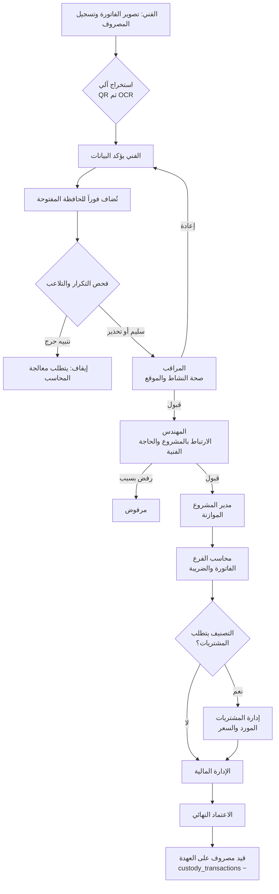
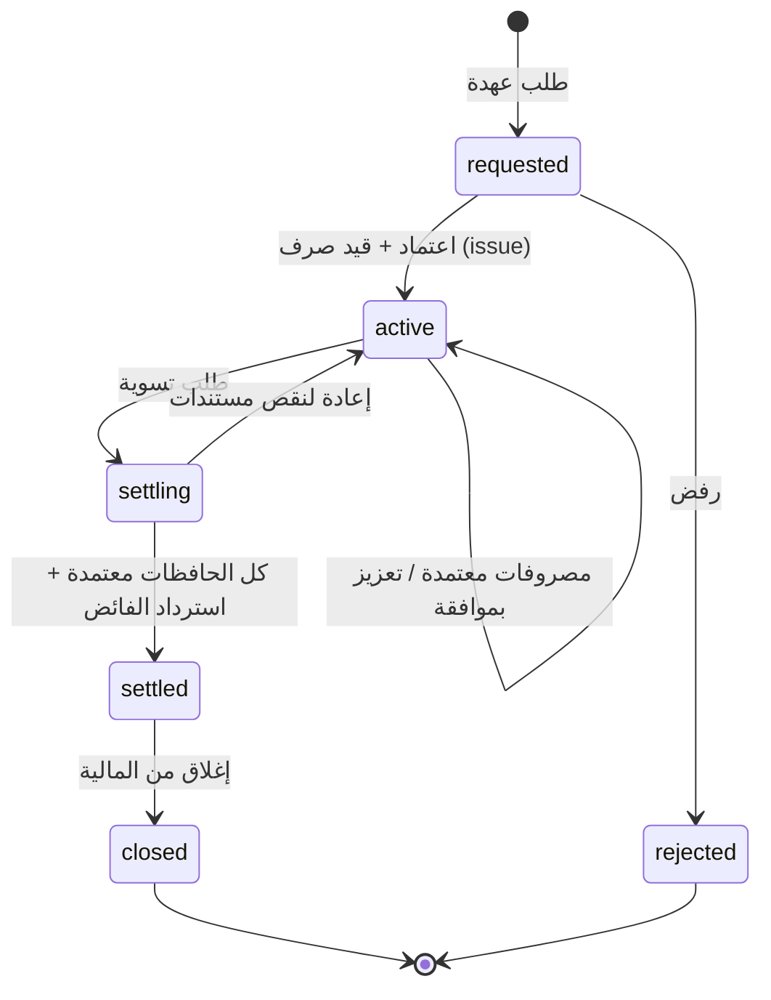
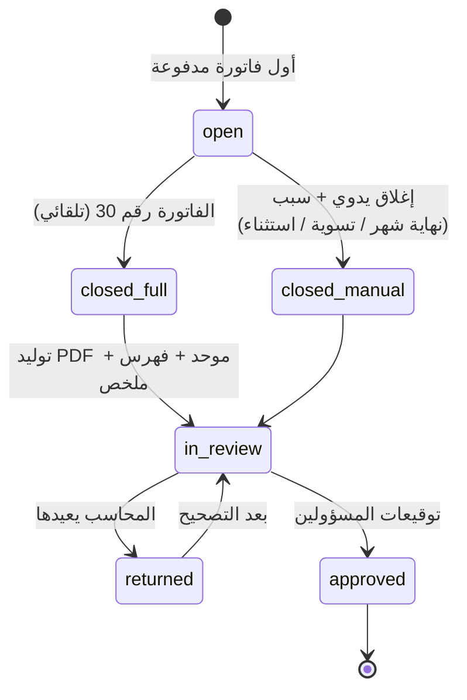
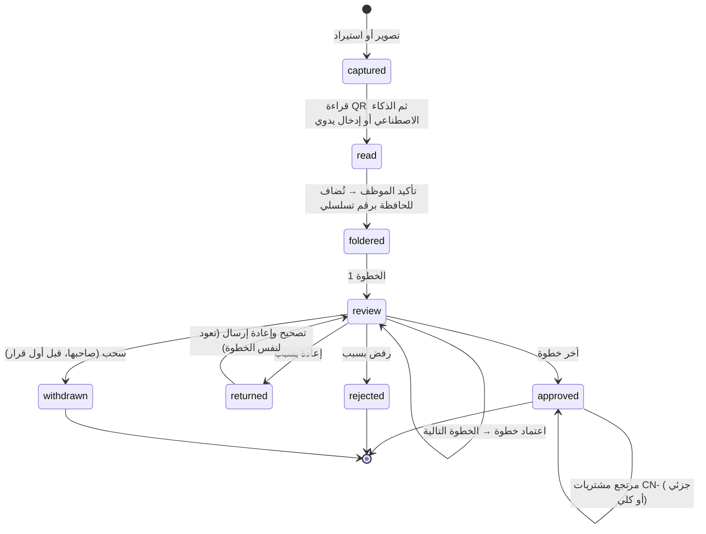

# دورة الاعتمادات — APPROVAL_WORKFLOW

محرك اعتمادات **قائم على البيانات**: المسار لا يُبرمج، بل يُعرَّف في `workflow_definitions` و`workflow_steps` ويمكن لكل شركة تعديله.

---

## 1. المسار الافتراضي للمصروف



**الإعادة** ترجع الطلب إلى صاحبه للتصحيح ثم يعود للخطوة نفسها. **الرفض** ينهي الطلب. كلاهما يتطلب كتابة سبب (مفروض في قاعدة البيانات).

## 2. المسار حسب المبلغ (مثال إعداد افتراضي)

لا يحتاج كل مصروف بقيمة 20 ريالاً إلى ثمانية توقيعات. نقترح ثلاثة مسارات تختار الشركة حدودها:

| المسار | المبلغ (شامل الضريبة) | الخطوات |
|---|---|---|
| سريع | حتى 500 ر.س | المراقب ← محاسب الفرع |
| عادي | 500 – 5,000 ر.س | المراقب ← المهندس ← مدير المشروع ← محاسب الفرع ← المالية |
| كامل | أكثر من 5,000 ر.س | المسار الكامل أعلاه + المشتريات + الاعتماد النهائي |

يُختار المسار تلقائياً بمطابقة `min_amount`/`max_amount`/`category_id`، والأولوية للأقل `priority`.

## 3. دورة حياة العهدة



**شرط التسوية:** الرصيد = صفر بعد قيد الاسترداد، ولا توجد مصروفات معلّقة، وكل الحافظات معتمدة.

## 4. دورة حياة الحافظة



عند إغلاق الحافظة تُفتح حافظة جديدة للعهدة نفسها تلقائياً عند أول فاتورة تالية (حافظة مفتوحة واحدة فقط لكل عهدة — مفروض في قاعدة البيانات).

> **القرار المعتمد: الفاتورة تدخل الحافظة عند الدفع.** فور إرسال المصروف تأخذ الفاتورة رقمها التالي في الحافظة المفتوحة، فيتطابق ترتيب الحافظة مع ترتيب الأصول الورقية. إذا رُفضت لاحقاً تبقى في مكانها وتُحسب في خانة "المرفوض" بملخص الحافظة، ولا تُحذف منها.

## 5. قواعد المحرك

| القاعدة | التنفيذ |
|---|---|
| لا تخطي للخطوات | SK011 في قاعدة البيانات |
| فصل المهام | SK010 في قاعدة البيانات |
| تجاوز حد الاعتماد | تصعيد تلقائي للخطوة التالية القادرة |
| خطوة شرطية | `is_conditional` + `condition_expr` (مثال: المشتريات فقط إن كان التصنيف يتطلبها) |
| مهلة | `sla_hours`؛ تنبيه للمعتمد ثم لمديره عند التأخر |
| غياب المعتمد | تفويض مؤقت مسجّل (المرحلة 4) |
| تعديل المسار أثناء طلب قائم | الطلب يكمل على النسخة التي بدأ بها |

---

## 6. دورة حياة الفاتورة (الإصدار 0.3)



| الإجراء | من | الشرط | الأثر |
|---|---|---|---|
| **سحب** | صاحب الفاتورة | قبل أي قرار عليها | تبقى في مكانها بالحافظة بعلامة «مسحوبة»، ولا تُحذف |
| **إعادة للتصحيح** | معتمد الخطوة الحالية | سبب إلزامي | تعود للموظف؛ بعد التصحيح تعود لنفس الخطوة، أو للبداية إذا تغيّر المسار بسبب تغيّر المبلغ |
| **رفض** | معتمد الخطوة الحالية | سبب إلزامي | نهائي؛ يظهر المبلغ في خانة «المرفوض» بالحافظة |
| **مرتجع مشتريات** | المحاسب، المشتريات، المالية | فاتورة معتمدة؛ مجموع المرتجعات ≤ قيمة الفاتورة | رقم CN- متسلسل، والمبلغ يعود إلى رصيد العهدة (مختبَر T32–T35) |

كل حدث يُسجَّل في `invoice_events` (إلحاقي) ويظهر للمستخدم كخط زمني في صفحة الفاتورة، مع الخطوات القادمة بانتظار أصحابها.

## 7. التوريدات والمطابقة الثلاثية

```
طلب شراء (فني/مراقب/مهندس) → 3 عروض أسعار → المشتريات تختار وتُصدر أمر الشراء
   → إذا تجاوز 5,000 ر.س: اعتماد مدير المشروع
   → تسجيل الاستلام (من الموقع) → مطابقة فاتورة المورد
   → مطابق ✓ أو غير مطابق ⚠ (الكمية المطلوبة ≠ المستلمة ≠ المفوترة)
```
