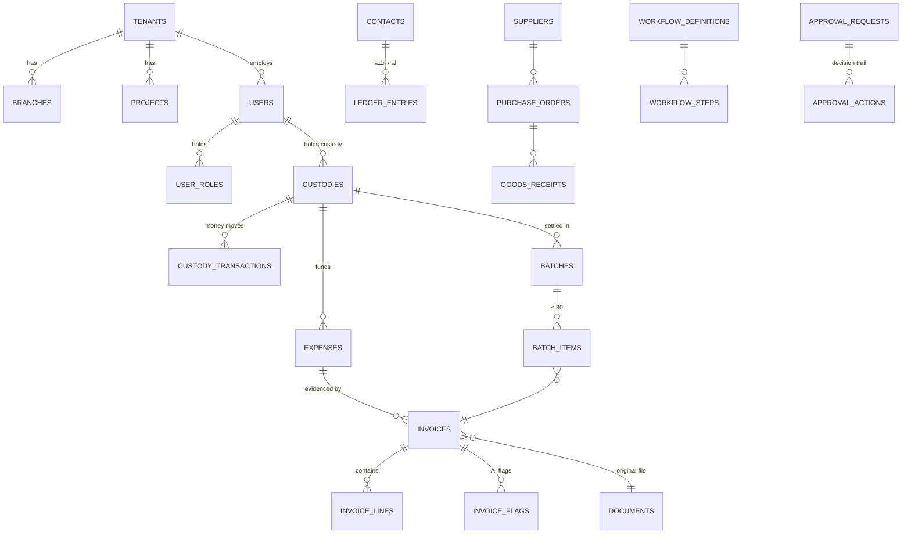

# نموذج قاعدة البيانات — DATABASE_SCHEMA

الملف التنفيذي: [`db/schema.sql`](../db/schema.sql) — PostgreSQL 16
الاختبارات: [`db/tests.sql`](../db/tests.sql) — **56 اختباراً، جميعها ناجحة** (انظر §6)

---

## 1. مبادئ التصميم

| المبدأ | التطبيق |
|---|---|
| عزل الشركات | كل جدول عمل يحمل `tenant_id`، ويُعزل بسياسات Row-Level Security في قاعدة البيانات نفسها (وليس في التطبيق فقط) |
| الأرصدة لا تُخزَّن | رصيد العميل والعهدة والحافظة يُحسب من الحركات عبر Views. هذا يمنع مشكلة "الأرصدة الخاطئة بعد التحديث" التي ظهرت في مراجعات التطبيق المرجعي |
| السجل المالي لا يُمحى | جداول الحركات والاعتمادات والمستندات والتدقيق **إلحاقية فقط**؛ التصحيح يتم بقيد عكسي |
| المعتمد مجمَّد | المصروف أو الفاتورة بعد الاعتماد أو الرفض لا يُعدَّل ولا يُحذف؛ الانتقال الوحيد المسموح: معتمد ← معكوس |
| سجل تدقيق مقاوم للتلاعب | كل سطر يحمل بصمة SHA-256 مربوطة بالسطر السابق؛ أي تعديل مباشر ينكشف |
| المزامنة دون تكرار | كل عملية من الجهاز تحمل `client_uuid` فريداً؛ إعادة الإرسال لا تُنشئ نسخة ثانية |
| المال بدقة | `NUMERIC(18,2)` — حساب عشري دقيق بلا أخطاء الفاصلة العائمة |
| التوقيت الحقيقي | `recorded_at` يضعه الخادم ولا يمكن للمستخدم تغييره، بجانب `occurred_at` الذي يدخله المستخدم |

---

## 2. مخطط العلاقات (مبسّط)



---

## 3. الجداول حسب الوحدة

### التنظيم والمستخدمون (H)
| الجدول | الغرض |
|---|---|
| `tenants` | الشركة + سياساتها (منع عهدة ثانية، السماح بالسحب على المكشوف، حد الحافظة) |
| `branches`, `departments`, `projects`, `cost_centers` | الهيكل التنظيمي |
| `users` | الحساب، الرقم الوظيفي، المدير المباشر (`manager_id`)، اللغة (6 لغات)، المظهر |
| `user_roles` | دور + نطاق (شركة/فرع/مشروع/فريق/ذاتي) + حد اعتماد |
| `user_sessions` | الأجهزة والجلسات المصرح بها |

### دفتر الحسابات (A)
| الجدول | الغرض |
|---|---|
| `contacts` | عميل/مورد/فرد/جهة، قابل للتحويل، رصيد افتتاحي |
| `ledger_entries` | "أعطيت / أخذت" — إلحاقي فقط |
| `payment_reminders` | تذكير بموعد وقناة (واتساب/SMS/إشعار) |
| View `contact_balances` | الرصيد = الافتتاحي + أعطيت − أخذت |

### العُهد (B)
| الجدول | الغرض |
|---|---|
| `custodies` | رقم العهدة (`CU-000001`)، النوع (10 أنواع)، صاحبها، المشروع، الحالة |
| `custody_transactions` | صرف (+)، تعزيز (+)، مصروف (−)، استرداد (−)، عكس — إلحاقي |
| View `custody_balances` | المسلَّم، المصروف، المسترد، الرصيد، تحت المراجعة، المرفوض |

### المصروفات والفواتير (C, D)
| الجدول | الغرض |
|---|---|
| `expense_categories` | التصنيفات الـ12، وهل تتطلب مرور المشتريات |
| `expenses` | رقم العملية (`EX-0000001`) وكل الحقول المطلوبة + حالة الاعتماد |
| `documents` | الملف الأصلي: بصمة SHA-256 (تكرار حرفي) + pHash (تكرار مرئي) + EXIF (كشف تعديل) — إلحاقي |
| `invoices` | نوع الفاتورة (6 أنواع) + بيانات الفاتورة المستخرجة + المصدر (QR/OCR/يدوي) + الثقة + **من أكّدها بشرياً** |
| `invoice_lines` | الأصناف والكميات والأسعار — أساس مقارنة الأسعار |
| `invoice_flags` | تنبيهات الذكاء الاصطناعي (11 نوعاً) ومن عالجها |

### الحافظات (F)
| الجدول | الغرض |
|---|---|
| `batches` | رقم الحافظة (`BT-000001`)، الحالة، سبب الإغلاق، ملف PDF الموحد |
| `batch_items` | الفاتورة + ترتيبها (1–30) |
| `batch_signatures` | توقيعات المسؤولين مع بصمة ملخص الحافظة وقت التوقيع |
| View `batch_summaries` | العدد، الإجمالي، الضريبة، المعتمد، المرفوض، المعلّق، الفترة |

### المشتريات (E) — الحد الأدنى للمطابقة الثلاثية
`suppliers`, `purchase_orders`, `po_lines`, `goods_receipts`, `gr_lines`، و`invoices.po_id`.

### الدخول والهويات (الإصدار 0.3)
| الجدول | الغرض |
|---|---|
| `user_identities` | ربط حساب Google بالمستخدم (`sub` + البريد)، فريد لكل مزوّد |
| `user_sessions.via` | طريقة الدخول: كلمة مرور أو Google |

### المرتجعات ودورة الحياة والنسخ (الإصدار 0.3)
| الجدول | الغرض |
|---|---|
| `invoice_credits` | مرتجعات المشتريات CN-، تُعيد المبلغ إلى العهدة تلقائياً — إلحاقي |
| `invoice_events` | كل حدث في حياة الفاتورة (تصوير، قراءة، حافظة ورقم، اعتماد، إعادة، رفض، سحب، مرتجع) — إلحاقي |
| `backup_runs` | سجل النسخ الاحتياطي والتصدير: النوع، النطاق، مكان الحفظ، البصمة — إلحاقي |

### الحسابات وكلمات المرور (الإصدار 0.4)
| الجدول / الحقل | الغرض |
|---|---|
| `users.status` | بانتظار الاعتماد · نشط · مقفل · موقوف |
| `users.must_change_password` | كلمة مؤقتة من الشركة يجب تغييرها عند أول دخول |
| `users.failed_logins` + `record_login_failure()` | القفل عند المحاولة الخامسة الفاشلة |
| `account_requests` | طلب حساب من الموظف؛ يقرّره مدير النظام |
| `password_reset_requests` + `admin_reset_password()` | «نسيت كلمة المرور» يصل للإدارة؛ إعادة التعيين تفك القفل وتفرض التغيير |
| `branches.region/governorate`, `projects.budget/pm_user_id` | الفروع بالمحافظات المسجلة، ميزانية المشروع ومديره |
| `comments`, `notifications` | التعليقات (إلحاقية) والإشعارات لكل مستخدم |

### الفئات والتكاملات (الإصدار 0.5)
| الجدول | الغرض |
|---|---|
| `tenants.plan` | أفراد · مؤسسة صغيرة · شركة كبرى |
| `outbound_messages` | رسائل واتساب للأعمال: القالب، الرقم، الحالة |
| `integration_connections` | اتصال واحد لكل نظام ERP لكل شركة؛ السر في خزنة (`secret_ref`) |
| `gl_account_mappings` | ربط التصنيفات بأرقام حسابات ERP |
| `erp_sync_log` + `batches.locked_at` | سجل الإرسال؛ الإرسال الناجح يقفل الحافظة |
| `personal_expenses`, `personal_budgets` | المصروف الشخصي والميزانية الشهرية |
| `personal_custodies`, `personal_custody_moves`, View `personal_custody_balances` | العهد الشخصية المستلمة والمسلّمة |

### الاعتمادات (G)
| الجدول | الغرض |
|---|---|
| `workflow_definitions` | مسار لكل نوع عملية + شروط المبلغ والتصنيف |
| `workflow_steps` | الخطوات بالترتيب، الدور، طريقة تحديد المعتمد، خطوة شرطية، السماح بالاعتماد الذاتي، مهلة SLA |
| `approval_requests` | الطلب الجاري وخطوته الحالية |
| `approval_actions` | كل قرار (اعتماد/رفض/إعادة/ملاحظة) — إلحاقي، والرفض والإعادة يتطلبان سبباً |

### التدقيق
`audit_log` — من، ماذا، متى، القيمة قبل وبعد، IP، وسلسلة البصمات.

---

## 4. القواعد المفروضة داخل قاعدة البيانات

| الرمز | القاعدة |
|---|---|
| SK001 | منع تعديل أو حذف الجداول الإلحاقية |
| SK002 | منع حذف مصروف أو فاتورة خرجت من حالة المسودة |
| SK003 | تجميد المصروف/الفاتورة بعد القرار |
| SK004 | منع فتح عهدة لشخص لديه عهدة غير مسوّاة (حسب سياسة الشركة) |
| SK005 | منع الحركة على عهدة مغلقة أو مرفوضة |
| SK006 | منع تجاوز رصيد العهدة (إلا إذا سمحت السياسة) |
| SK007 | منع الإضافة إلى حافظة مغلقة |
| SK008 | منع تجاوز 30 فاتورة في الحافظة |
| — | إغلاق الحافظة تلقائياً عند الفاتورة رقم 30 |
| SK009 | منع إزالة فاتورة من حافظة مغلقة |
| — | الإغلاق اليدوي المبكر يتطلب سبباً موثقاً |
| SK010 | فصل المهام: صاحب الطلب لا يعتمده |
| SK011 | منع تخطي خطوات الاعتماد |
| SK012 | المرتجع فقط على فاتورة معتمدة |
| SK013 | مجموع المرتجعات لا يتجاوز قيمة الفاتورة |
| SK014 | لا مرتجعات بعد تصدير الحافظة للمحاسبة |
| SK015 | صرف العهدة الشخصية لا يتجاوز المتبقي |
| SK016 | لا حركة على عهدة شخصية مسوّاة |
| SK017 | رابط الدفع بالبطاقة يحتاج بوابة مربوطة |
| SK018 | طلب التحويل يحتاج آيبان صحيحاً |
| SK019 | رابط الدفع المدفوع أو الملغى أو المنتهي لا يتغير |
| SK020 | لا سحب من الادخار أكثر من المدَّخر |
| — | الفاتورة المسحوبة مجمّدة ولا تعود |
| — | حساب Gmail واحد لمستخدم واحد |
| — | تكرار (الرقم الضريبي + رقم الفاتورة) مرفوض |
| — | الرقم الضريبي يجب أن يكون 15 رقماً يبدأ وينتهي بـ 3 |
| — | الفاتورة الضريبية تتطلب الرقم الضريبي للمورد |
| — | الفاتورة العادية لا تحمل ضريبة قابلة للاسترداد |

---

## 5. ما يُنفَّذ في طبقة التطبيق (لا قاعدة البيانات)

- **نطاق البيانات** داخل الشركة (مشروع/فرع/فريق): يُطبَّق في الـ API مع اختبارات صلاحيات مخصصة. سبب عدم وضعه في RLS الآن: تعقيد الأداء مع تعدد الأدوار؛ يمكن نقله لاحقاً.
- تحديد المعتمِد الفعلي لكل خطوة (المدير المباشر، مهندس المشروع…).
- مقارنة pHash للتكرار المرئي ومقارنة الأسعار.
- تشفير كلمات المرور (argon2id) وأسرار MFA.

---

## 6. نتيجة الاختبارات

```
PASS  T01 RLS: tenant A sees only its own 2 users
PASS  T02 RLS: cannot write into another tenant
PASS  T03 ledger: balance derived = 500 − 200 = 300
PASS  T04 ledger: entries cannot be edited
PASS  T05 ledger: entries cannot be deleted
PASS  T06 sync: same client_uuid cannot be recorded twice
PASS  T07 custody: no second custody while one is unsettled
PASS  T08 custody: spend cannot exceed balance (no overdraft)
PASS  T09 custody: expense must carry a negative sign
PASS  T10 invoice: same supplier VAT + invoice number rejected as duplicate
PASS  T11 expense: approved expense amount cannot change
PASS  T12 expense: approved expense cannot be deleted
PASS  T13 expense: approved → reversed is the only allowed change
PASS  T14 batch: auto-closed at exactly 30 invoices
PASS  T15 batch: 31st invoice refused (batch closed)
PASS  T16 batch: summary = 30 invoices, 300.00 total, 39.00 VAT
PASS  T17 batch: invoices cannot be removed from a closed batch
PASS  T18 batch: manual early close requires a documented reason
PASS  T19 workflow: requester cannot approve own request
PASS  T20 workflow: rejection without a reason is refused
PASS  T21 workflow: cannot skip ahead to step 2
PASS  T22 audit: changes were logged automatically
PASS  T23 audit: app role cannot delete audit rows
PASS  T24 audit: hash chain verifies intact
PASS  T25 audit: direct tampering is detected by the hash chain
PASS  T26 RLS: tenant B sees none of tenant A's expenses or custodies
PASS  T27 invoice: malformed Saudi VAT number refused
PASS  T28 invoice: tax invoice without supplier VAT number refused
PASS  T29 invoice: regular (non-tax) invoice cannot claim VAT
PASS  T30 folder: invoice added at payment; its later rejection shows as 205.00 rejected
PASS  T31 identity: one Gmail cannot be linked to two users
PASS  T32 return: 85.00 credit goes back to the advance balance
PASS  T33 lifecycle: the return is recorded as an invoice event
PASS  T34 return: total returns cannot exceed the invoice (85 + 150 > 230)
PASS  T35 return: not allowed on a rejected invoice
PASS  T36 withdraw: a withdrawn invoice cannot be revived
PASS  T37 accounts: 5th failed sign-in locks the account
PASS  T38 accounts: only one open reset request per user
PASS  T39 accounts: admin reset unlocks, forces a password change and closes the request
PASS  T40 ERP: one connection per system per company
PASS  T41 ERP: account codes must be 3–10 digits
PASS  T42 ERP: a successful send locks the folder
PASS  T43 ERP: no purchase returns after the folder was exported
PASS  T44 personal: spending cannot exceed what is left in a custody (200 > 180)
PASS  T45 personal: custody balance = 500 − 320 = 180
PASS  T46 payments: IBAN check accepts a valid Saudi IBAN and rejects a wrong check digit or another country
PASS  T47 payments: an invalid IBAN cannot be saved
PASS  T48 payments: a card link needs a connected gateway
PASS  T49 payments: an expired link cannot be marked paid
PASS  T50 payments: paying a link records the money received in the ledger (balance 1,200 → 0)
PASS  T51 payments: a paid link can no longer change
PASS  T52 payments: an invoice is billed to a client only once
PASS  T53 savings: you cannot take out more than is saved (3,000 > 2,500)
PASS  T54 savings: saved 2,500 of 10,000, 7,500 to go
PASS  T55 policy: the standard limit must be above the quick limit
PASS  T56 policy: each company's own limits decide the approval path (800 is quick at 1,000; default elsewhere)
ALL TESTS PASSED
```

التشغيل: `psql -v ON_ERROR_STOP=1 -f db/schema.sql -f db/tests.sql`
