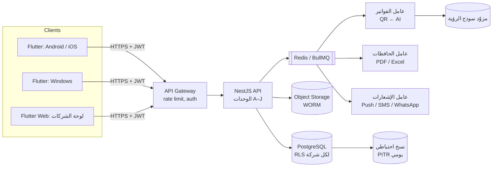

# البنية التقنية — SYSTEM_ARCHITECTURE

## 1. تقييم التقنيات والاختيار

| الطبقة | الاختيار | البدائل التي قُيّمت | سبب الاختيار |
|---|---|---|---|
| التطبيق (Android, iOS, Windows, Web, لوحي) | **Flutter 3** | React Native، .NET MAUI، تطبيقات منفصلة | قاعدة شيفرة واحدة لكل المنصات المطلوبة بما فيها Windows؛ دعم ممتاز لـ RTL؛ كاميرا وPDF محلياً |
| التخزين المحلي (دون إنترنت) | **Drift (SQLite)** مشفّر بـ SQLCipher | Hive، Isar | استعلامات SQL حقيقية للأرصدة دون اتصال، وتشفير |
| الخادم | **NestJS (TypeScript)** | Django، Laravel، .NET | بنية معيارية للوحدات الكثيرة، أنواع صارمة، OpenAPI تلقائي، نظام بيئي واسع |
| قاعدة البيانات | **PostgreSQL 16** | MySQL | RLS لعزل الشركات، NUMERIC دقيق، JSONB لمخرجات الذكاء الاصطناعي، Triggers للقواعد المالية |
| تخزين المستندات | **S3-compatible** بنمط WORM (Object Lock) | نظام ملفات | الأصل لا يُعدَّل ولا يُحذف؛ يمكن استضافته داخل المملكة |
| الطوابير | **Redis + BullMQ** | RabbitMQ | OCR، توليد PDF، التذكيرات، فحص التكرار — مهام خلفية |
| واجهة API | **REST + OpenAPI** | GraphQL | أبسط للتدقيق والتخزين المؤقت والصلاحيات؛ GraphQL غير ضروري هنا |
| تحقق البريد (مرحلة تأسيسية) | **رمز OTP عبر Gmail API OAuth2 من NestJS** | كلمة مرور تطبيق Gmail | الرمز يُرسل من الخادم فقط، والأسرار لا تصل للمتصفح |
| الذكاء الاصطناعي | قارئ QR محلي ← نموذج رؤية (Gemini أو Claude) خلف واجهة مزوّد قابلة للاستبدال | OCR تقليدي فقط | نماذج الرؤية تفهم الفواتير العربية غير المنظمة؛ الواجهة المجردة تمنع الارتباط بمزوّد واحد |
| PDF / Excel | pdf-lib + خطوط عربية مضمّنة / ExcelJS | — | دعم العربية في PDF يحتاج تشكيل نص صحيح |

## 2. المخطط العام



## 3. محرك ذكاء الفواتير (مسار الاستخراج)

```
صورة/PDF
  │
  ├─ 0. تحديد نوع الفاتورة: ضريبية مبسطة، ضريبية قياسية، عادية/نقدية، مشتريات (أمر شراء)، إشعار دائن، أخرى
  ├─ 1. حفظ الأصل (SHA-256 + pHash + EXIF) ← فحص تكرار حرفي ومرئي فوراً
  ├─ 2. (الضريبية فقط) قراءة QR الفاتورة الضريبية (TLV: البائع، الرقم الضريبي، الوقت، الإجمالي، الضريبة)
  │      إن نجح: هذه الحقول موثوقة بنسبة عالية دون ذكاء اصطناعي
  ├─ 3. نموذج الرؤية (المسار الوحيد للفواتير العادية المكتوبة باليد أو المطبوعة دون QR): الأصناف، الكميات، الأسعار، الخصم، طريقة الدفع + أي حقل لم يوجد في QR
  ├─ 4. تحقق حسابي: Σ البنود − الخصم + الضريبة = الإجمالي ؛ الضريبة ≈ 15% ؛ صيغة الرقم الضريبي
  ├─ 5. تحقق تقاطعي: QR مقابل النص المقروء (اختلاف ← تنبيه تلاعب محتمل)
  ├─ 6. مقارنة أسعار الأصناف بسجل المورد وبقية الموردين
  └─ 7. عرض النتيجة للمستخدم بحقول ملوّنة حسب الثقة ← تأكيد بشري إلزامي
```

**الذكاء الاصطناعي لا يعتمد شيئاً.** مخرجاته تُحفظ كاملة في `raw_extraction` ويُسجَّل من أكّدها.

## 4. العمل دون إنترنت والمزامنة

| القاعدة | التنفيذ |
|---|---|
| مسموح دون اتصال | تسجيل مصروف، تصوير فاتورة، حركة دفتر، عرض الأرصدة المخزنة |
| يحتاج اتصالاً | الاعتمادات، فتح عهدة، إغلاق حافظة، استخراج الذكاء الاصطناعي |
| منع التكرار | كل عملية تحمل `client_uuid` يُولَّد على الجهاز؛ قيد فريد في الخادم (مختبَر T06) |
| التعارض | الحركات المالية إلحاقية فلا تعارض في الكتابة؛ البيانات الوصفية: آخر كتابة تفوز مع سجل |
| الوقت | `occurred_at` من الجهاز، `recorded_at` من الخادم؛ فرق كبير بينهما يظهر للمراجع |

## 5. البيئات

- **تطوير:** Docker Compose (PostgreSQL، Redis، MinIO).
- **إنتاج مقترح:** مزوّد سحابي بمنطقة داخل المملكة (لمتطلبات نظام حماية البيانات الشخصية)، PostgreSQL مُدار مع استرجاع لحظي، تخزين كائنات مع Object Lock.
- **نموذج الويب الحالي:** يبقى نموذجًا تجريبيًا محليًا؛ خدمة OTP الجديدة لا تنقل سجلاته ولا تجعل صلاحيات الواجهة موثوقة. قبل بيانات الإنتاج يجب نقل عمليات القراءة والكتابة والصلاحيات كلها إلى API مع تحقق خادمي وRLS.

## 5.1 أساس تسجيل الدخول بالبريد

توجد خدمة أولية في `server/`: ترسل رمزًا عشوائيًا صالحًا لعشر دقائق إلى البريد المسجّل لمستخدم نشط، وتخزن HMAC للرمز فقط. تحد المحاولات من التخمين وإعادة الإرسال، وتصدر الجلسة رمز وصول قصير العمر مع إمكانية إلغائه. إرسال الرسالة يتم عبر Gmail API OAuth2 من الخادم؛ هذا إثبات امتلاك صندوق البريد وليس تسجيل دخول Google OIDC. الخدمة لا تنشئ الحسابات ولا تمنح أدوارًا، والنموذج الثابت لا يستخدم رمز الجلسة لحماية بيانات مالية بعد.

## 6. أنواع الفواتير وقواعدها

| النوع | QR | رقم ضريبي للمورد | ضريبة قابلة للاسترداد | ملاحظات |
|---|---|---|---|---|
| ضريبية مبسطة | نعم | إلزامي | نعم | الأكثر شيوعاً في الوقود والمطاعم |
| ضريبية قياسية | نعم (المرحلة الثانية) | إلزامي | نعم | تحمل رقم المشتري الضريبي |
| عادية / نقدية | لا | — | **لا** | محلات صغيرة غير مسجلة؛ تُقرأ بالذكاء الاصطناعي وتتطلب تأكيد المحاسب |
| مشتريات | حسب المورد | حسب المورد | حسب المورد | تُطابق مع أمر الشراء والاستلام |
| إشعار دائن | حسب المورد | حسب المورد | بالسالب | يُنقص مبلغ فاتورة سابقة |
| أخرى | — | — | لا | إيصال أو مستند يقبله المحاسب استثناءً |

القواعد الثلاث الأولى مفروضة في قاعدة البيانات (T27–T29).

## 7. الواجهة متعددة اللغات

ست لغات (ar, en, ur, hi, bn, fil)، اتجاهان (RTL للعربية والأردية). في Flutter: ملفات ARB لكل لغة عبر `flutter_localizations`، والخطوط حسب اللغة كما في DESIGN_SYSTEM.md.
